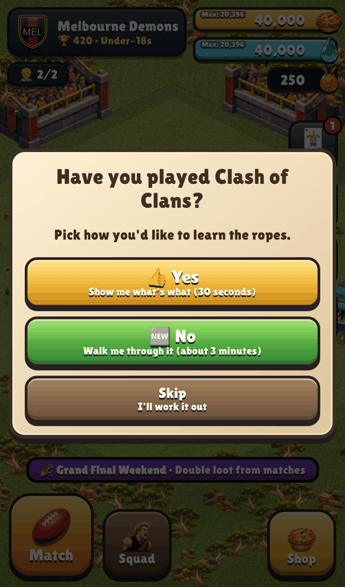
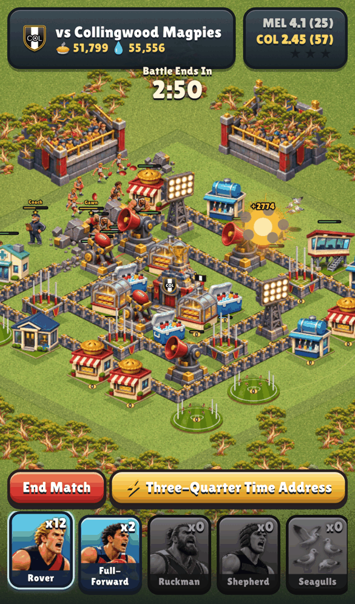
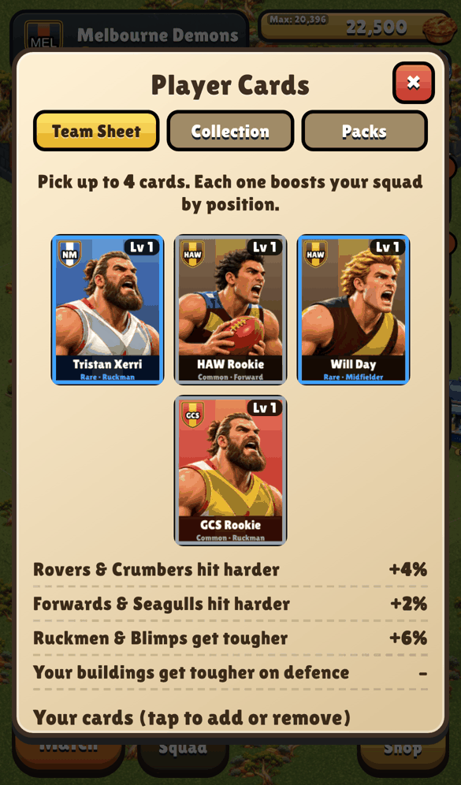
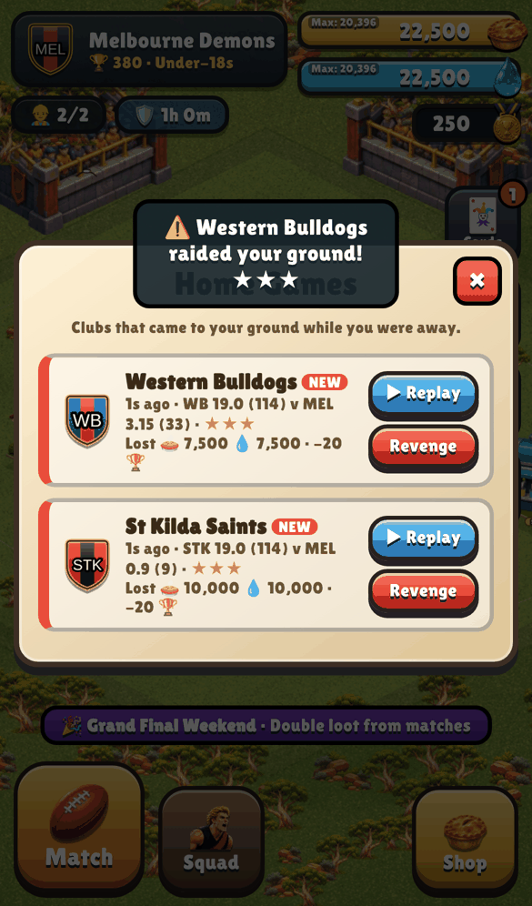

# Footy Fortress

A Clash-style base builder with all 18 AFL clubs. Play at **https://footy-fortress.pages.dev** or open `index.html` in a browser. Made for phones; progress saves on the device.

Unofficial fan game, not affiliated with the AFL or its clubs.

## Install it like an app
First visit shows how: one tap on Android, Share → Add to Home Screen on iPhone. Settings has **Install** and **Check for updates** (saves, clears cached files and reloads the newest version). Works offline once installed.

## Play online (free)
Settings → **Sign in / Sign up** with email + password (plus a display name for the leaderboard). Your club saves to the cloud and follows you to any device. Online you get:
- **Find a Match** against real players near your trophies, plus 24 labelled **bot** clubs so there's always someone to play. Tap **Next** to skip an opponent.
- **Home Games**: real attacks on your ground arrive with exact replays and a Revenge button.
- **Leaderboard** and **Cheer Squads** (clans) with chat and friendly matches — tap 🏟️ **Online**.
- Lost password? Use the recovery code shown at sign-up.

The server is `server/api.js`, bundled into the Pages worker by `deploy.sh`, with a Cloudflare D1 database (`footy-fortress-db`) bound as `DB`.

## How to play
- **Pick your club.** Your hero is a star player from it; the Head Coach unlocks at Clubhouse 5.
- **Build and upgrade** with groundskeepers. Pie Shops and Drink Taps make 🥧 and 💧; Pie Warmers and Eskies store them. Clubhouse goes to level 8, buildings to level 10.
- **Defend** with Goal Towers, Siren Cannons, Kick-Out Catapults, Floodlight Towers (anti-air), hidden Sprinkler Traps and Fences.
- **Train** at the Training Oval: Rovers, Full-Forwards, Ruckmen (go for defences), Crumbers (go for loot), Shepherds (smash fences), Seagulls and Blimps (air), Trainers (heal).
- **Spells** from the Physio Room: Half-time Oranges, Crowd Roar, Umpire's Free Kick, Rain Delay, Late Sub. **Research** in the Coaches Box.
- **Player cards:** 72 cards (captains are Legends). Win packs, level duplicates, and put up to 5 on your Team Sheet to boost players by position.
- **Home Games:** AI clubs raid your ground even while you're away. Watch replays, take revenge, and get a shield after a big loss.
- **Daily tasks, weekday events, shop deals and sound.** Brownlow votes 🏅 are the premium currency, earned in game.
- **Controls:** drag to pan, pinch or scroll to zoom. Tap a building for options; drag a selected one to move it. In matches, tap to deploy or hold to send a stream.
- **Tutorials:** a quick "what's what" for Clash players and a guided walkthrough for new players, both replayable from Settings.

## Footy rules
- **Scoring:** every building you knock down is a goal (6); one smashed past half is a behind (1). The home side gets a behind for every building still standing and every player it knocks out (a goal for big players and heroes). Highest score at the siren wins.
- **Stars:** ★ win, ★★ win + Clubhouse down, ★★★ whole ground flattened.
- **Season:** 17 rounds against an 18-club ladder, 4 points a win, percentage splits ties, top 8 play finals through to a Grand Final.

## Files
- `js/data.js`: clubs, colours, heroes, players (checked for the 2027 season), buildings, units, spells, cards. Edit names here.
- `js/game.js` home base and saves, `js/battle.js` match engine, `js/season.js` ladder and finals, `js/raid.js` AI raids, `js/ui.js` menus and controls, `js/tutorial.js` tutorials, `js/install.js` install prompt and updates, `js/audio.js` sound.
- `js/render.js` drawing helpers and fallback art; `js/art.js` + `art/sheets.js` the painted sprites (club colours applied at runtime).
- `logos/`: drop club logo PNGs here to replace the generated badges (file names in its README).
- `js/net.js`: accounts, cloud sync, online matches, inbox, leaderboard, squads. `server/api.js`: the online API.
- `deploy.sh`: publishes to Cloudflare Pages (needs a Pages:Edit API token). `CF_BRANCH=name ./deploy.sh` makes a preview.

## Art
Painted sprite sheets in `art/sheets.js` include individual portraits, ready stances and running poses for all 18 in-game captains. Each 3×3 captain sheet has one player per column and one pose per row. Other players use role art recoloured in each club's guernsey.

The captain sprites are original generated illustrations based on [AFL Photos](https://www.afl.com.au/news/1275233), [club leaders](https://www.afl.com.au/news/1550873), and [official team portraits](https://www.afl.com.au/news/1462772). The source photos are reference only. Nick Daicos has a [No. 35](https://www.collingwoodfc.com.au/news/1252573/no-35) portrait badge and a gold effect when fired up.

   
