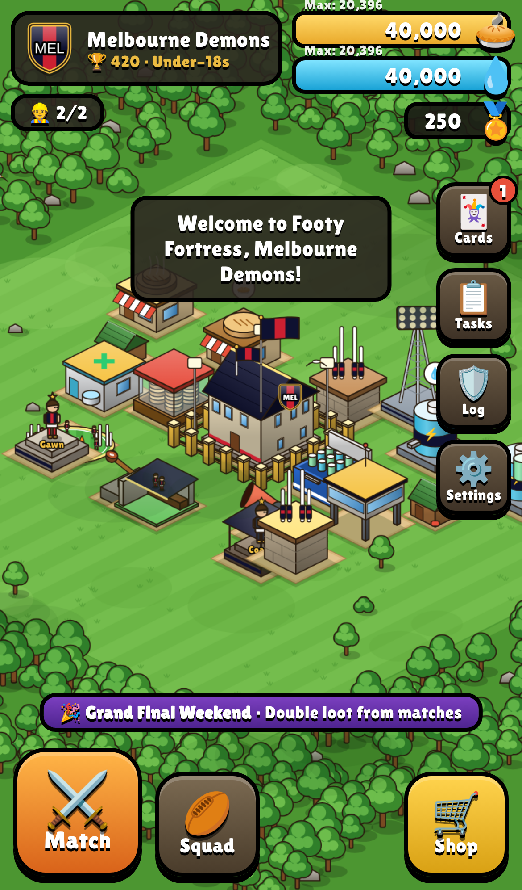
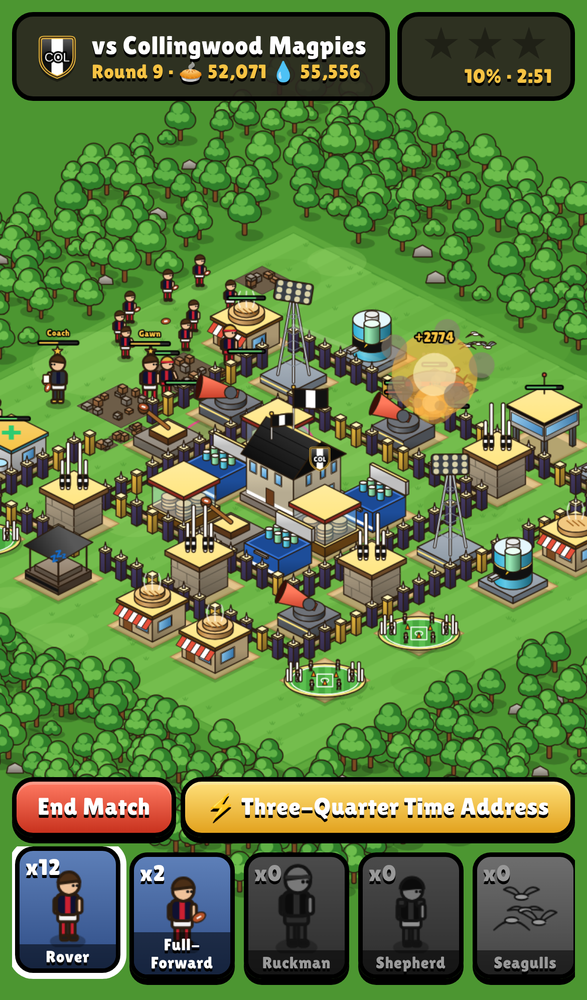
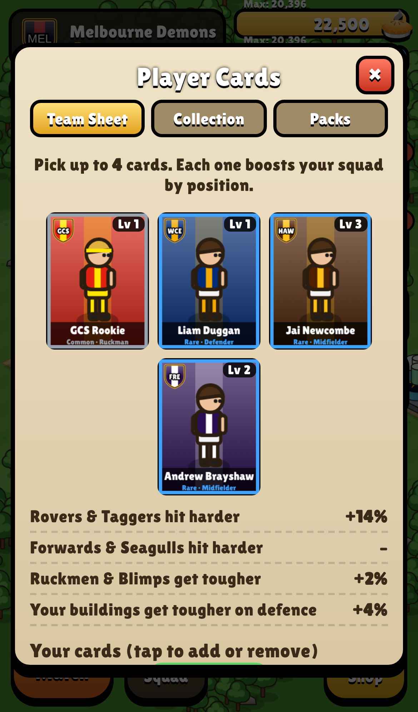
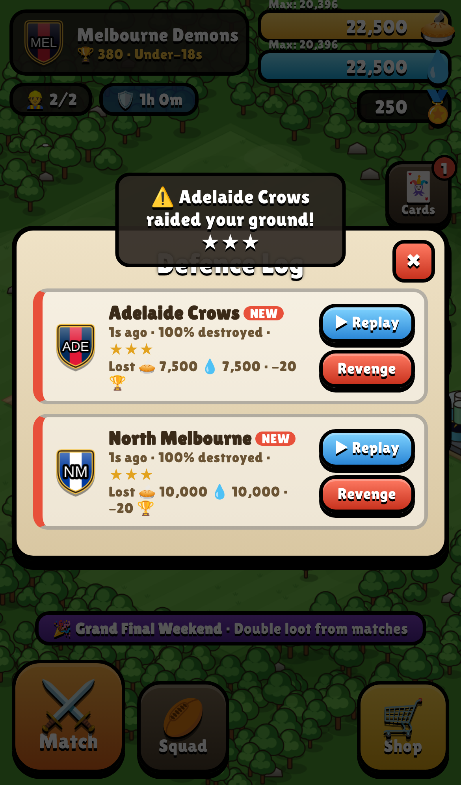

# Footy Fortress

A base-building strategy game with all 18 AFL clubs. Open `index.html` in a browser (made for phones). No install, progress saves on the device.

## New in Round 1
- **Get raided:** rival clubs attack your ground every so often (even while you're away). Check the Defence Log, watch replays, hit Revenge. Big losses give you a shield.
- **Player cards:** 72 cards (captains are Legends). Win packs from matches and tasks, level up duplicates, and pick a Team Sheet that boosts your squad.
- **More to unlock:** Clubhouse up to 8, buildings up to level 10, Seagulls and Blimps (air), Floodlight Towers (anti-air), Rain Delay and Late Sub spells, and a second hero, the Head Coach.
- **Daily tasks, weekly events, shop deals and sound effects.**
- **Club badges** everywhere. Add your own logos in `logos/` (see the README there).

## How to play
- **Pick your club.** Your captain is one of the club's star players (e.g. Nick Daicos, Max Gawn, Marcus Bontempelli).
- **Build & upgrade** with groundskeepers (builders): Pie Shops and Drink Taps make resources; Pie Warmers and Eskies store them; upgrade the Clubhouse to unlock more.
- **Defend** with Goal Towers, Siren Cannons, Kick-Out Catapults, hidden Sprinkler Traps and Fences.
- **Train your squad** at the Training Oval: Rovers, Full-Forwards, Ruckmen (go for defences), Taggers (go for loot), Shepherds (smash fences), Trainers (heal).
- **Spells** from the Physio Room: Half-time Oranges (heal), Crowd Roar (rage), Umpire's Free Kick (strike).
- **Research** in the Coaches Box to level up players. **Upgrade your captain** and use their special ability in matches.
- **Match Day:** play the 17-round Season Fixture + Grand Final, or Find a Match for loot and trophies. 50% = ★, Clubhouse = ★, 100% = ★.
- Drag to pan, pinch/scroll to zoom. Tap a building for options; drag a selected building to move it. In matches, tap to deploy or hold to send a stream.

Edit captains/colours in `js/data.js`. Club names and colours only; no official logos.

   
